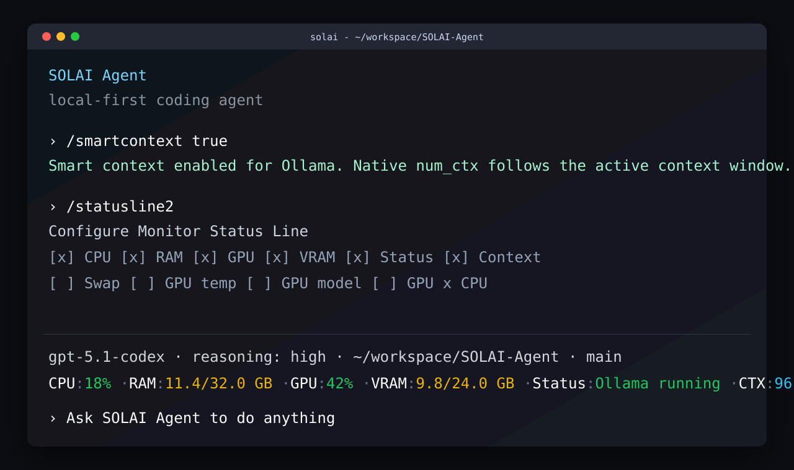

# SOLAI Coder

> 🚀 **SOLAI is available on Algorex (SOLAI/USDT).**
> Everyone can participate and become part of the AI + DePIN ecosystem from the beginning. 🔥
> Buy $SOLAI: https://algorex.net/trade/SOLAI-USDT
>
> HOLDERS of $SOLAI will be able to rent their inference power to other SOLAI Coder users and earn $SOLAI in return.

SOLAI Coder is a local-first AI agent and coding environment built around the `solai` CLI.

## SOLAI Node

SOLAI Node is the inference bridge for the SOLAI ecosystem. It is developed as a
private runtime and can be used in two ways:

- embedded inside SOLAI Coder for the default user experience
- installed separately for partners and external applications that only need inference

SOLAI Coder remains the public local-first coding experience. When Node is available,
the Coder can administer it from inside the CLI/TUI so users do not need to operate
the runtime manually for common local workflows.

Public progress is tracked in the [SOLAI Node Docs](https://github.com/solai-ai/solai-node-docs).

## Node administration

The `solai node` command connects Coder to a running SOLAI Node. It can check the
runtime, register an Ollama provider, submit a chat job, and wait for the real model
response:

```bash
export SOLAI_NODE_URL=http://127.0.0.1:9876

solai node health
solai node ready
solai node metrics
solai node runtime
solai node mode paused
solai node mode running
solai node probe OLLAMA_HOST:11434
solai node chat --provider PROVIDER_ID --model gemma3:4b \
  "Reply with only SOLAI_OK"
solai node events --kind job_completed --limit 25
solai node metering --tenant solai-coder-local --model gemma3:4b --limit 25
solai node jobs list --status completed --limit 25
solai node jobs detail JOB_ID
solai node jobs route JOB_ID
solai node jobs assign JOB_ID --provider PROVIDER_ID
solai node jobs cancel JOB_ID
solai node jobs retry JOB_ID
solai node providers list --status available --model gemma3:4b --min-available-slots 1 --sort available-capacity --limit 25
solai node providers get PROVIDER_ID
solai node providers refresh PROVIDER_ID
solai node providers unavailable PROVIDER_ID
solai node providers disable PROVIDER_ID
solai node providers enable PROVIDER_ID
solai node providers delete PROVIDER_ID --yes
solai node providers price PROVIDER_ID --model gemma3:4b --solai-per-hour 1.25
solai node providers schedule PROVIDER_ID --from 22:00 --to 07:00 --timezone America/Sao_Paulo
solai node providers heartbeat PROVIDER_ID --status available --capacity 4 --active-jobs 0
solai node providers heartbeat PROVIDER_ID --clear-capacity
```

Omit `--provider` to let Node route the job automatically. Add `--json` to print
the complete job detail, including metering. If Node authentication is enabled, set
`SOLAI_NODE_API_KEY`; using the environment avoids exposing the key in shell history.
Event and metering reads default to 50 records and reject limits above the Node
maximum of 500.
Job listing follows the same bounded limit and supports status, workload, provider,
tenant, and model filters. Cancellation and retry are explicit lifecycle actions;
retry creates a new job attempt instead of overwriting the original record.
Provider controls preserve the Node lifecycle rules. Deleting a provider requires
`--yes` and is still rejected by Node while active jobs reference that provider.
Prices must be positive decimal values; schedules use 24-hour `HH:MM` times and
can include an IANA timezone. Heartbeats can update a provider's availability,
capacity, and active-job count. Omit `--status` to update capacity without
changing the provider's current availability state. Coder rejects an active-job
count greater than supplied capacity before sending the request.
Use `--clear-capacity` when the provider no longer reports trustworthy capacity
telemetry; it removes the persisted capacity and active-job values.
When Node rejects a request with a structured error, Coder prints its error code
and message. Authorization failures also explain how to configure
`SOLAI_NODE_API_KEY`.

Node remains the source of truth for provider state, inference jobs, routing,
metering, and runtime policy.

## Install

```bash
npm install -g @solaiecosystem/solai
```

## Local model setup

Use the built-in provider flow to point SOLAI Agent at a local model server.

1. Open `/provider_conf`
2. Enter an address such as `127.0.0.1:11434`
3. SOLAI Agent probes the endpoint, checks `/api/tags` and `/v1/models`, and stores the detected provider and model
4. Use `/model` to pick the model exposed by the server and adjust the reasoning effort for the current run

Useful commands:

```text
/provider_conf
/model
/smartcontext true
```

For Ollama-backed models, `/smartcontext true` enables native smart context sizing. SOLAI Agent
uses the active model context window to send the right `num_ctx` value to Ollama. Use
`/smartcontext false` to disable it again, or set it directly in `config.toml`:

```toml
ollama_smart_context = true
```

## Context control

SOLAI Agent keeps session history explicit and bounded.

```text
/context
/smartcontext
/mini-model
/resume-type
/new
/clear
/compact
```

- `/context` sets the maximum context window before auto-compaction
- `/smartcontext` toggles Ollama native context sizing for local models
- `/mini-model` sets the model used for context compaction
- `/resume-type` sets the compaction strategy
- `/new` opens another chat during a conversation
- `/clear` starts a fresh chat
- `/compact` trims history when the conversation gets long

## Web search

SOLAI Agent can use a local, credential-free web search backend in both normal and
lite context modes. The search server is exposed as a compact MCP endpoint and
is enabled when `SOLAI_AGENT_SEARCH_MCP_URL` points to a running instance.

Example:

```bash
export SOLAI_AGENT_SEARCH_MCP_URL=http://127.0.0.1:8000/mcp
```

If you do not want the built-in search server to participate in a session, set
`SOLAI_AGENT_SEARCH_MCP_DISABLED=1`.

In `/lite-agentctx` the search instructions are shorter, but the tool itself
remains available in the normal context as well.

## Monitor status line

Use `/statusline2` to configure a second footer line with monitor data from the local model host.
It can show CPU, RAM, swap, GPU, GPU model, VRAM, GPU temperature, Ollama runtime status, context
usage, and GPU/CPU split.

```text
/statusline2
```

You can also configure it in `config.toml`:

```toml
[tui]
status_line_2 = ["cpu", "ram", "gpu", "vram", "status", "context"]
status_line_2_use_colors = true
```

When a local provider is configured, SOLAI Agent reads monitor metrics from the provider host on
port `9898` at `/metrics`; the line stays hidden until metrics are available.



## What it includes

- Terminal workflow
- App server integration
- Python SDK
- TypeScript SDK
- Workspace-aware sandbox and approval rules

## Support

SOLAI Coder is the free local agent and coder layer for the SOLAI ecosystem.

## More

- [Repository](https://github.com/solai-ai/solai-coder)
- [SOLAI website](https://solai-ai.github.io)
